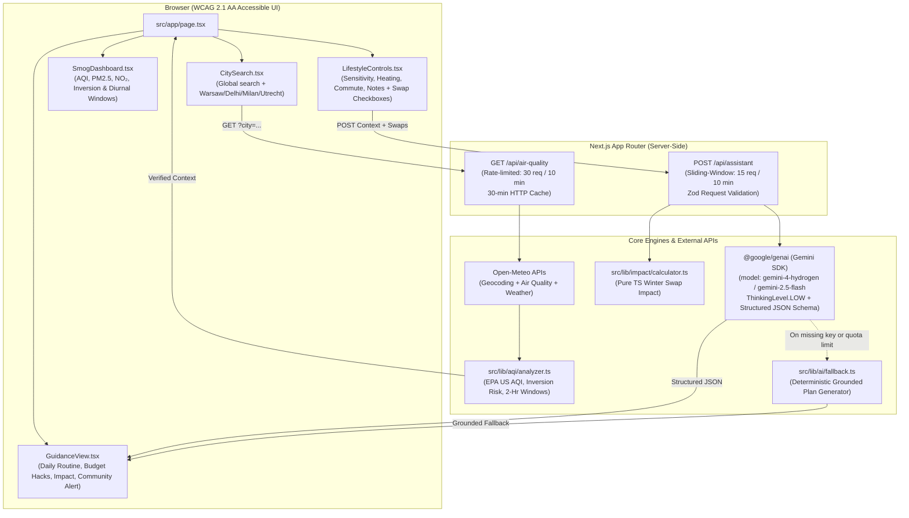

# SmogWise Family 🌫️🏡

> **Empathetic, Science-Grounded Urban Air Quality & Winter Smog Assistant for Families and Local Communities.**

[](https://nextjs.org/)
[](https://www.typescriptlang.org/)
[](https://tailwindcss.com/)
[](https://ai.google.dev/)
[](https://www.w3.org/WAI/standards-guidelines/wcag/)
[](https://vitest.dev/)

---

## 📖 Table of Contents
1. [Project Overview](#-project-overview)
2. [Problem Statement Alignment](#-problem-statement-alignment)
3. [Architecture Diagram](#-architecture-diagram)
4. [Tech Stack](#-tech-stack)
5. [Key Capabilities](#-key-capabilities)
6. [Local Setup & Configuration](#-local-setup--configuration)
7. [Running Tests & Audits](#-running-tests--audits)
8. [Security & Privacy Audit](#-security--privacy-audit)
9. [WCAG 2.1 AA Accessibility Features](#-wcag-21-aa-accessibility-features)
10. [Deployment to Vercel](#-deployment-to-vercel)

---

## 🌟 Project Overview

**SmogWise Family** is a production-grade Next.js web application built to help urban households navigate severe winter air pollution. When cold air is trapped beneath a warmer atmospheric layer (thermal inversion), ground-level pollutants from vehicle tailpipes and residential heating cannot rise, creating concentrated ground-level soot bowls.

SmogWise turns real-time, verified local pollution readings (US AQI, PM2.5, PM10, NO₂) and weather metrics into **practical, zero/low-cost daily actions** and **measurable neighborhood emission reductions**.

---

## 🎯 Problem Statement Alignment

| Problem Challenge | SmogWise Solution |
| :--- | :--- |
| **Winter Thermal Inversions** | Algorithm calculates real-time inversion risk (`Low` / `Moderate` / `High`) based on surface temperature ($\le$ 5°C), stagnant winds (< 10 km/h), and elevated PM2.5 ($\ge$ 35 µg/m³). |
| **Timing Outdoor Exposure** | Scans 24-hour diurnal curves to automatically detect the **Cleanest 2-Hour Window** (afternoon solar warming) and **Peak Smog Window** (nighttime/morning ground trap). |
| **Household Budget Barriers** | Prioritizes zero-cost and low-cost indoor air hacks (damp microfiber dusting, rolled towel draft stoppers, kitchen back-burner range hood protocols, DIY box-fan MERV-13 filters). |
| **Neighborhood Emissions** | Pure TypeScript impact engine calculates exact monthly avoided **PM2.5 (g)** and **CO₂ (kg)** for realistic winter swaps (skipping fireplace nights, transit school runs, 1°C thermostat setback). |
| **Community Collective Action** | Generates 1-click copyable WhatsApp / neighborhood alert cards so families can coordinate clean-air windows with building neighbors. |
| **Responsible Communication** | Plain 6th–8th grade language, no fear-mongering, and clear medical disclaimers advising healthcare consultations for acute respiratory symptoms. |

---

## 🏛️ Architecture Diagram



---

## 🛠️ Tech Stack

- **Framework:** [Next.js 15 (App Router)](https://nextjs.org/)
- **Language:** [TypeScript](https://www.typescriptlang.org/) (Strict mode enabled)
- **Styling:** [Tailwind CSS v3](https://tailwindcss.com/) with high-contrast color tokens
- **GenAI SDK:** [`@google/genai`](https://www.npmjs.com/package/@google/genai) with native `z.toJSONSchema` structured outputs
- **Validation:** [Zod v4](https://zod.dev/)
- **Icons:** [Lucide React](https://lucide.dev/)
- **Testing:** [Vitest](https://vitest.dev/), `@testing-library/react`, `@testing-library/jest-dom`, `jsdom`
- **Data Source:** [Open-Meteo](https://open-meteo.com/) (Free public APIs, CC BY 4.0, zero API keys required)

---

## ✨ Key Capabilities

### 1. Diurnal Clean-Air & Peak Smog Window Detection
Winter pollution in urban valleys exhibits an extreme diurnal oscillation:
- **Nighttime & Morning:** Strong ground cooling traps smoke in a shallow layer ($< 50$ meters).
- **Early Afternoon (12:30 PM – 2:30 PM):** Sunlight warms the soil surface, breaking the atmospheric inversion lid and diluting surface PM2.5 by **35% to 45%**.
- SmogWise scans the 24-hour forecast curve to pinpoint the exact 2-hour window when families can safely air out their homes or run essential errands.

### 2. Live Emission Reductions Calculator
Every winter swap provides instant, scientifically grounded feedback:
- **Skip Fireplace Nights:** $-36.0\text{ kg CO}_2$, $-450.0\text{ g PM}_{2.5}$ per month.
- **Transit School Runs:** $-24.5\text{ kg CO}_2$, $-160.0\text{ g PM}_{2.5}$ per month.
- **Lower Thermostat 1°C:** $-18.0\text{ kg CO}_2$, $-28.0\text{ g PM}_{2.5}$ per month.
- **Shift Errands Off-Peak:** $-9.5\text{ kg CO}_2$, $-75.0\text{ g PM}_{2.5}$ per month.
- **Electric Induction/Kettle Swap:** $-11.0\text{ kg CO}_2$, $-42.0\text{ g PM}_{2.5}$ per month.

### 3. Tiered Budget Indoor Air Quality Hacks
- **Free:** Damp microfiber dusting (prevents resuspending PM10 soot), rolled-towel door draft stoppers (cuts outdoor particle drafting by 25%), back-burner stove exhaust protocols.
- **Low-Cost:** DIY Box-Fan filters (MERV-13 pleated HVAC filter taped to a standard box fan), delivering commercial-grade Clean Air Delivery Rates ($> 180\text{ CFM}$) for $\sim\$25$.
- **Equipment:** True HEPA purifier sizing and continuous bedroom isolation protocols.

---

## 💻 Local Setup & Configuration

### 1. Clone & Install
```bash
git clone https://github.com/palakgoda/smogwise-family.git
cd smogwise-family
npm install
```

### 2. Environment Configuration
Create a `.env` file in the root directory (refer to `.env.example`):
```env
# Get a free key from Google AI Studio (https://aistudio.google.com/)
GEMINI_API_KEY=your_gemini_api_key_here

# Optional: defaults to gemini-4-hydrogen (or gemini-2.5-flash)
GEMINI_MODEL=gemini-4-hydrogen
```
> [!NOTE]
> **Zero-Key Deterministic Fallback Mode:**
> If `GEMINI_API_KEY` is omitted or set to the placeholder string, SmogWise Family automatically activates its deterministic rule-based guidance engine ([`src/lib/ai/fallback.ts`](file:///c:/Users/admin/Desktop/smogwise-family/src/lib/ai/fallback.ts)), allowing reviewers and developers to test the application offline with zero friction!

### 3. Run Development Server
```bash
npm run dev
```
Open [http://localhost:3000](http://localhost:3000) in your browser.

---

## 🧪 Running Tests & Audits

SmogWise includes a comprehensive test suite covering schema boundaries, impact arithmetic, inversion edge cases, rate limiting, and Gemini API mocking:

```bash
# 1. Typecheck with strict TypeScript
npx tsc --noEmit

# 2. Lint with ESLint
npm run lint

# 3. Run all Vitest unit and mock tests (45 tests)
npm test

# 4. Production build check
npm run build
```

---

## 🔒 Security & Privacy Audit

1. **Zero Secret Leakage:**
   - `GEMINI_API_KEY` is strictly accessed within server-side API route handlers ([`src/lib/ai/gemini.ts`](file:///c:/Users/admin/Desktop/smogwise-family/src/lib/ai/gemini.ts)).
   - No `NEXT_PUBLIC_` prefixes are used for secrets; client bundles were audited and verified to contain zero API keys or environment variables.
2. **Untrusted Context Isolation:**
   - Free-form user inputs (`familyProfile.customNotes`) are treated strictly as untrusted data.
   - `sanitizeCustomNotes` automatically strips HTML tags (`<...>`), purges ASCII control characters, and caps length at 200 characters.
   - System instructions explicitly direct the AI to ignore any prompt injection instructions embedded in notes.
3. **Sliding-Window IP Rate Limiting:**
   - In-memory sliding-window limiter prevents API abuse, quota exhaustion, and denial of service (15 requests per 10 minutes per IP on `/api/assistant`).

---

## ♿ WCAG 2.1 AA Accessibility Features

- **Non-Color Reliance:** Air Quality ratings and Inversion risks never rely on color alone. Every severity level pairs high-contrast foreground/background colors with an explicit textual classification badge (e.g., `Level 6: Hazardous (301+)`) and distinct Lucide icons (`CheckCircle2`, `AlertCircle`, `AlertTriangle`, `ShieldAlert`).
- **Semantic HTML Landmarks:** Proper use of `<header role="banner">`, `<main id="main-content">`, `<section aria-labelledby="...">`, `<footer role="contentinfo">`, and an accessible skip-to-content link.
- **Interactive Keyboard Navigation:**
  - AI Guidance tabs implement standard WAI-ARIA tablist patterns (`role="tablist"`, `role="tab"`, `role="tabpanel"`, `aria-selected`, `aria-controls`) with Left/Right Arrow, Home, and End key navigation.
  - Interactive checkboxes and buttons feature high-contrast `focus-visible:ring-2` focus rings.
- **Screen Reader Announcements (`aria-live="polite"`):**
  - Live Air Quality dashboard updates, pre-calculated emission scoreboard changes, and "Copied to Clipboard!" actions trigger polite screen-reader announcements.

---

## 🚀 Deployment to Vercel

SmogWise Family is optimized for zero-configuration deployment on [Vercel](https://vercel.com/):

1. **Import Repository:** Connect your GitHub repository to Vercel.
2. **Framework Preset:** Select **Next.js** (automatically detected).
3. **Environment Variables:**
   - `GEMINI_API_KEY`: Your Google AI Studio API key.
   - `GEMINI_MODEL`: `gemini-4-hydrogen` or `gemini-2.5-flash`.
4. **Deploy:** Click **Deploy**. Vercel will automatically run `npm run build` and provision Edge CDN routes for 30-minute sensor caching.

---

## 📜 Attribution & License

- **Environmental Data:** Open-Meteo Air Quality & Weather APIs ([CC BY 4.0](https://creativecommons.org/licenses/by/4.0/)).
- **License:** [MIT License](LICENSE) — Copyright © 2026 Palak Goda.
